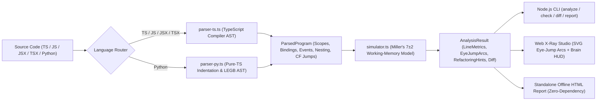

<div align="center">

# CogTrace

**Working-Memory Cognitive Load Simulator & Eye-Jump Visualizer for Code**

[](https://github.com/xnezerxx/cogtrace/actions/workflows/ci.yml)
[](https://xnezerxx.github.io/cogtrace/)
[](./LICENSE)
[](https://www.typescriptlang.org/)
[](https://nodejs.org/)

[**Launch Interactive Web X-Ray Studio →**](https://xnezerxx.github.io/cogtrace/)

</div>

---

Traditional complexity metrics count `if` statements. **Human brains don't fail on branches — they fail when working memory overflows Miller's `7±2` register limit** and a reader's eyes have to jump 45 lines upward to remember whether `discount` was mutated inside a closure or shadowed inside a loop.

**CogTrace** runs real static AST scope & liveness analysis for **TypeScript, JavaScript (JSX/TSX), and Python** — identically in **Node.js CLI** and **100% client-side in the browser** — to simulate what occupies a developer's working memory on every line of code.

---

## Architecture Pipeline



---

## What CogTrace Measures

| Cognitive Dimension | How CogTrace Models It | Why It Hurts Readability |
| --- | --- | --- |
| **Working-Memory Slots (`Miller's 7±2`)** | Real liveness analysis: each data binding occupies 1 register from `defLine` through `lastUseLine`. Linear cost up to capacity (`7`), **super-linear overflow penalty** above `7`. | Juggling 10+ simultaneous live variables causes mental register thrashing and subtle bugs. |
| **Eye-Jump Arcs (`def→read`, `def→write`, `write→read`)** | Measures exact vertical line distance between every read/write and its declaration or most recent mutation. | Long vertical saccades break reading flow and force scrolling back to verify invariants. |
| **State Mutation Tracking** | Detects `=`, `+=`, `++`, property writes (`obj.x = ...`), and in-place mutations (`.push()`, `.set()`, `.append()`, `.update()`). | Every mutation forces readers to invalidate and rewrite a variable's mental value. |
| **Variable Shadowing** | Tracks lexical scope chains across blocks, functions, lambdas, and Python comprehensions. | Reusing an outer name forces constant mental disambiguation (`which item is this?`). |
| **Closure Captures** | Detects reads/writes crossing enclosing function boundaries (including Python `nonlocal`). | Mutable cross-boundary captures create hidden temporal coupling. |
| **Nesting & Non-Linear Control Flow** | Tracks syntactic/block depth and `break`, `continue`, `throw`/`raise`, `catch`/`except`, and early `return`. | Stack-depth pressure + non-linear jumps multiply working-memory retention cost. |

---

## Feature Matrix

| Capability | Web X-Ray Studio | Node.js CLI | Standalone HTML Report |
| --- | :---: | :---: | :---: |
| TypeScript / JavaScript / JSX / TSX real Compiler API AST | Yes | Yes | Embedded |
| Pure-TypeScript Python LEGB, indentation, f-strings & comprehensions | Yes | Yes | Embedded |
| Interactive Line Heatmap & Miller 7-Slot Brain HUD | Yes | ANSI Gauge | Yes |
| Curved Glowing SVG Eye-Jump Arcs + Variable Isolation | Yes | Distance Metrics | Yes |
| Before / After Refactor Arena (`compareRefactor`) | Yes | `cogtrace diff` | — |
| CI Quality Gate (`--max-slots`, `--max-score`, exit code `1`) | — | `cogtrace check` | — |
| Zero External Runtime / Offline Capable | 100% Client-Side | Local Node.js | Single `.html` File |

---

## Quick Start

### 1. Try Online (Zero Install)
Open the [**Interactive Web X-Ray Studio**](https://xnezerxx.github.io/cogtrace/) — paste any TypeScript, JavaScript, or Python code, hover or click any line to inspect glowing SVG eye-jump arcs, or switch to the **Before / After Refactor Arena**.

### 2. Run Locally (CLI & Web Studio)

```bash
git clone https://github.com/xnezerxx/cogtrace.git
cd cogtrace
npm install
npm run build
```

Launch the Web Studio locally:

```bash
npm run dev
```

---

## CLI Usage

### `cogtrace analyze <file-or-dir>`
Analyzes one file or recursively scans a directory (`.ts`, `.tsx`, `.js`, `.jsx`, `.py`), printing a cognitive grade, Miller slot gauge, ANSI thermal sparkline, top hotspots, and prioritized refactoring hints.

```bash
node dist/cli/index.js analyze checkout-legacy.ts
# Machine-readable JSON:
node dist/cli/index.js analyze src/ --json
```

Example output:

```text
checkout-legacy.ts (typescript, 76 code lines)  Grade  F 
  WM Peak:  [■■■■■■■] +6 OVERFLOW  13/7 slots (at L40)
  Score:    avg 70.3 · max 244.7 (L41) · overload lines: 35
  Metrics:  max jump 52L · mutations 13 · shadowed 1 · closures 3 · nesting 2
  Trace:    ▁▁▁▁▁▁▁▁▁▁▁▁▁▂▁▂▄▄▅▅▅▅▆▅▆▅▆▇▆██▆▆▇▃▃▃▄▅▂▂▃▂▃▂▁▁▃▃▃▃▁▂▂▂▁▂▁▂▂▁▁▁▁
  Top Hotspots:
    L41   13/7!  score 244.7  subtotal -= discount;
      live: couponCode, loyaltyPoints, regionTaxRate, isVip, subtotal, …
  Top Refactoring Hints (18 total):
    ✖ Peak working-memory overflow (13/7 slots) at lines 21–56
      Extract a cohesive pure helper function for this span so intermediate variables leave working memory immediately.
    ✖ Long-range variable lifetime: `warnings` spans 60 lines (L24→L84)
      Declare variables as close as possible to first use, or split the routine into smaller stage functions passing only required inputs.
```

### `cogtrace diff <beforeFile> <afterFile>`
Quantifies the exact cognitive load impact of a refactoring PR:

```bash
node dist/cli/index.js diff checkout-legacy.ts checkout-pipeline.ts
```

```text
CogTrace Refactor Cognitive Diff   IMPROVED (-82.5% load) 
  Before: checkout-legacy.ts
  After:  checkout-pipeline.ts

  Metric                 Before      After   Delta
  ────────────────────────────────────────────────────
  Grade                       F          A   F → A
  Peak WM Slots            13/7        7/7   -6
  Avg Load Score           70.3       12.3   -58
  Max Line Score          244.7       42.1   -202.6
  Overload Lines             35          0   -35
  Max Eye-Jump              52L        13L   -39L
  Mutations                  13          0   -13
  Refactor Hints             18          2   -16
```

### `cogtrace check <file-or-dir>` (CI Quality Gate)
Fails with exit code `1` whenever any file exceeds your working-memory or score budgets:

```bash
node dist/cli/index.js check src/ --max-slots 8 --max-score 90 --max-avg-score 35
```

### `cogtrace report <file> -o report.html`
Generates a completely self-contained, zero-dependency interactive HTML X-Ray visualizer you can attach to PRs or CI artifacts:

```bash
node dist/cli/index.js report checkout-legacy.ts -o checkout-xray.html
```

---

## Programmatic API

```ts
import { analyzeCode, compareRefactor, generateHtmlReport } from 'cogtrace';

const result = analyzeCode(sourceCode, {
  language: 'typescript',
  fileName: 'checkout.ts',
  capacity: 7
});

console.log(result.summary.grade, result.summary.peakSlots);
console.log(result.hints[0]?.title);

const diff = compareRefactor(legacyCode, cleanCode, 'typescript');
console.log(`Cognitive load reduced by ${diff.improvementPct}%`);

const standaloneHtml = generateHtmlReport(result);
```

---

## Development & Verification

```bash
npm run typecheck   # Strict TypeScript checking (tsc --noEmit)
npm test            # Full Vitest suite (parsers, simulator, HTML report, CLI)
npm run build       # Build Node.js CLI (dist/cli, dist/core) + Vite Web Studio (dist/web)
```

---

## Roadmap

- [ ] **GitHub PR Comment Bot Action**: Automatically post Before/After cognitive load diffs on pull requests.
- [ ] **Additional Language Parsers**: Go and Rust pure-TS scope/liveness frontends.
- [ ] **VS Code Extension**: Inline working-memory slot gutter decorations and hover eye-jump arcs.
- [ ] **Cross-Function Call-Graph Jump Depth**: Track inter-procedural navigation distance across local helpers.

---

## Contributing & License

Contributions are welcome — see [CONTRIBUTING.md](./CONTRIBUTING.md), [CODE_OF_CONDUCT.md](./CODE_OF_CONDUCT.md), and [SECURITY.md](./SECURITY.md).

Licensed under the [MIT License](./LICENSE) © 2026 [xnezerxx](https://github.com/xnezerxx).
